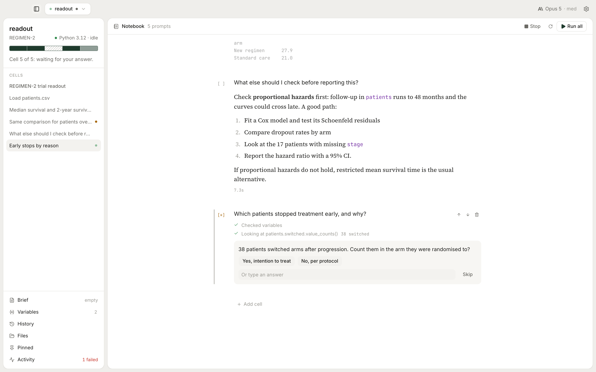
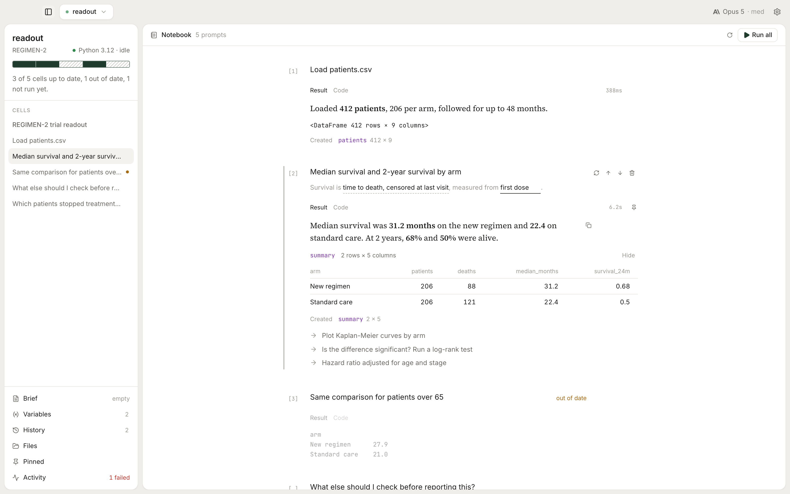
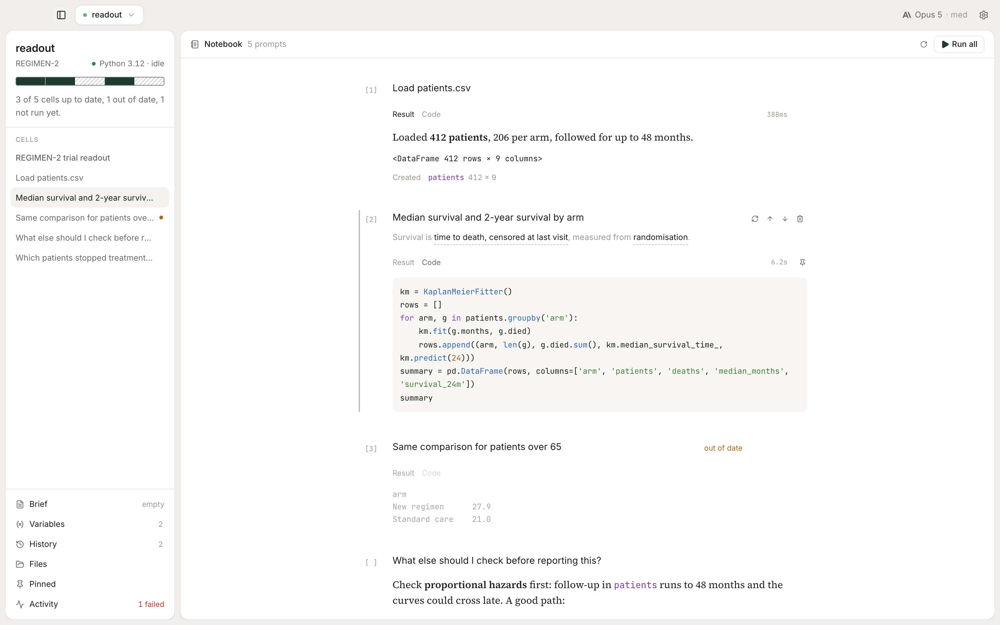
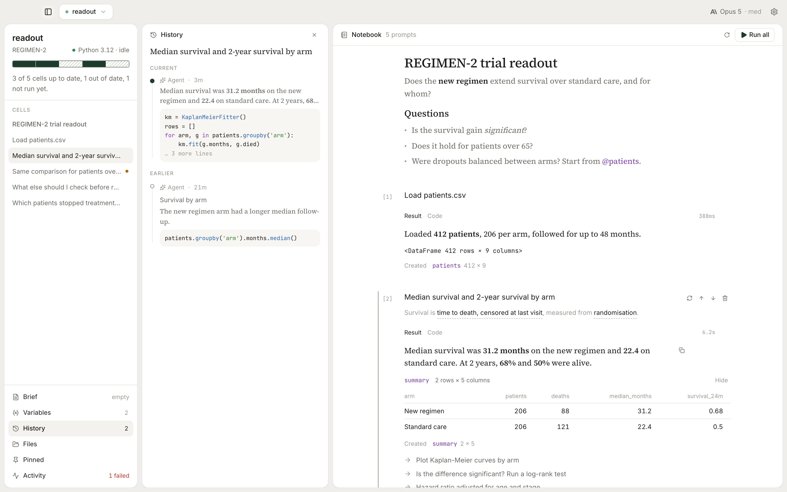

<div align="center">


# Dalliance

**The open-source coding agent for researchers.**

A notebook where you write each cell in plain language.<br>
Dalliance writes the Python, runs it on a live kernel and keeps the code that works.

[](https://github.com/amirhesham65/dalliance/releases/latest)
[](https://github.com/amirhesham65/dalliance/releases/latest/download/Dalliance.dmg)
[](#)
[](https://github.com/amirhesham65/dalliance/actions/workflows/ci.yml)

[**Download for Mac**](https://github.com/amirhesham65/dalliance/releases/latest/download/Dalliance.dmg) · [Website](https://dalliance.io) · [Docs](docs/README.md)

<br>

<picture>
  <source media="(prefers-color-scheme: dark)" srcset="apps/web/src/assets/shots/answer-dark.png">
  
</picture>

</div>

## Why

General coding agents are built to ship software. Research needs answers you can defend and notebooks a colleague can rerun. Dalliance is a notebook where you start from the question, and every answer comes with the code that made it.

### It shows how it read your question

- **Assumptions are editable.** The agent underlines how it read your prompt. Click one, correct it, and the cell regenerates.
- **It asks instead of guessing.** When a wrong reading would make the answer useless, the cell asks you a multiple-choice question.
- **One brief for the project.** Put definitions, exclusions and the study design in `AGENTS.md`. The agent reads it before every cell.

### Answers come from code that ran

- **It checks its own work.** The agent runs the code, reads the traceback and fixes it. A cell only finishes once its code succeeds.
- **The Python is always there.** One tab away, to read or edit.

### Reproducible by default

- **Verify from a clean start.** Restart Python, rerun every cell and see what came out the same, what changed and what failed. Random calls with no fixed seed get flagged.
- **The environment is pinned.** Each save records the Python version, the package versions and a SHA-256 of every file the cells read. Open the notebook later and a banner lists what changed.
- **Every cell keeps its record.** The notebook stores each cell's prompt, corrections, models and the files it read. History restores any of the last 12 versions.
- **Reruns are free.** An unchanged prompt reruns its saved code with no model call.
- **It's plain `.ipynb`.** Jupyter, GitHub and your reviewers open it as it is.

### Your Mac, your model

- **Python runs locally.** The agent reads only the notebook's folder, never `.env` files, and by default asks before code runs shell commands or uses the network.
- **Any model.** Claude Sonnet 5.5 by default, or anything on the Vercel AI Gateway or the Anthropic API.

<table>
  <tr>
    <td width="50%">
      <picture>
        <source media="(prefers-color-scheme: dark)" srcset="apps/web/src/assets/shots/ask-dark.png">
        
      </picture>
      <p align="center"><sub>Asks when the data is ambiguous</sub></p>
    </td>
    <td width="50%">
      <picture>
        <source media="(prefers-color-scheme: dark)" srcset="apps/web/src/assets/shots/guess-dark.png">
        
      </picture>
      <p align="center"><sub>Correct an assumption in place</sub></p>
    </td>
  </tr>
  <tr>
    <td width="50%">
      <picture>
        <source media="(prefers-color-scheme: dark)" srcset="apps/web/src/assets/shots/code-dark.png">
        
      </picture>
      <p align="center"><sub>The Python is always there to read and edit</sub></p>
    </td>
    <td width="50%">
      <picture>
        <source media="(prefers-color-scheme: dark)" srcset="apps/web/src/assets/shots/history-dark.png">
        
      </picture>
      <p align="center"><sub>Restore any earlier version</sub></p>
    </td>
  </tr>
</table>

## Install

Grab [**Dalliance.dmg**](https://github.com/amirhesham65/dalliance/releases/latest/download/Dalliance.dmg). It's a universal build for Apple Silicon and Intel Macs.

The first launch sets up a model key and a private Python environment with pandas, NumPy, matplotlib, SciPy, statsmodels, seaborn and scikit-learn. If your shell profile already exports `AI_GATEWAY_API_KEY` or `ANTHROPIC_API_KEY`, the app picks it up. You can skip either step and point the app at your own interpreter later.

## Build from source

You need Node, [pnpm](https://pnpm.io) and Python 3.

```bash
git clone https://github.com/amirhesham65/dalliance.git && cd dalliance
pnpm install
cp apps/desktop/.env.example apps/desktop/.env   # optional: add AI_GATEWAY_API_KEY, or add a key in Settings
pnpm dev
```

| Command | Does |
| --- | --- |
| `pnpm dev` | Electron with hot reload, plus the website on `:3100` |
| `pnpm test` | unit, component and kernel tests |
| `pnpm typecheck` / `pnpm lint` | type and lint checks |
| `pnpm --filter @dalliance/desktop dist:mac` | a universal `Dalliance.dmg` in `apps/desktop/release/` |

To look at the UI in a browser with sample data, run `pnpm --filter @dalliance/desktop exec vite preview` and open `/?demo`.

## Shortcuts

| Keys | |
| --- | --- |
| <kbd>⌘</kbd> <kbd>T</kbd> | New tab |
| <kbd>⌘</kbd> <kbd>W</kbd> | Close the tab, asking to save it first |
| <kbd>⌃</kbd> <kbd>Tab</kbd>, <kbd>⌃</kbd> <kbd>⇧</kbd> <kbd>Tab</kbd> | Next tab, previous tab. <kbd>⌘</kbd> <kbd>⇧</kbd> <kbd>]</kbd> and <kbd>⌘</kbd> <kbd>⇧</kbd> <kbd>[</kbd> too |
| <kbd>⌘</kbd> <kbd>B</kbd> | Show or hide the sidebar and side pane |
| <kbd>⌘</kbd> <kbd>1</kbd> … <kbd>6</kbd> | Brief, Variables & Environment, History, Files, Pinned, Activity |

## Under the hood

```
apps/desktop      Electron app: React renderer, Python kernel, the agent harness
apps/web          dalliance.io, Next.js and Tailwind v4
packages/shared   notebook model, .ipynb conversion, IPC contract
```

The [internal docs](docs/README.md) cover the architecture, the agent loop and its tools, the kernel protocol, the file format, testing and releases.

## License

The core is open source under the [Apache License 2.0](LICENSE): the notebook, the agent, the kernel and the file format, running on your own model key. Official builds can also sign in to Dalliance Cloud, a separate hosted service, to run models on a Dalliance plan instead. Every model through Dalliance Cloud runs with zero data retention. With your own key, data retention depends on your agreement with the provider. The service isn't in this repository, and builds from source leave it off.

The name, logo and icon are trademarks and aren't covered by the license. See [TRADEMARKS.md](TRADEMARKS.md).

Contributions are welcome. See [CONTRIBUTING.md](CONTRIBUTING.md).
