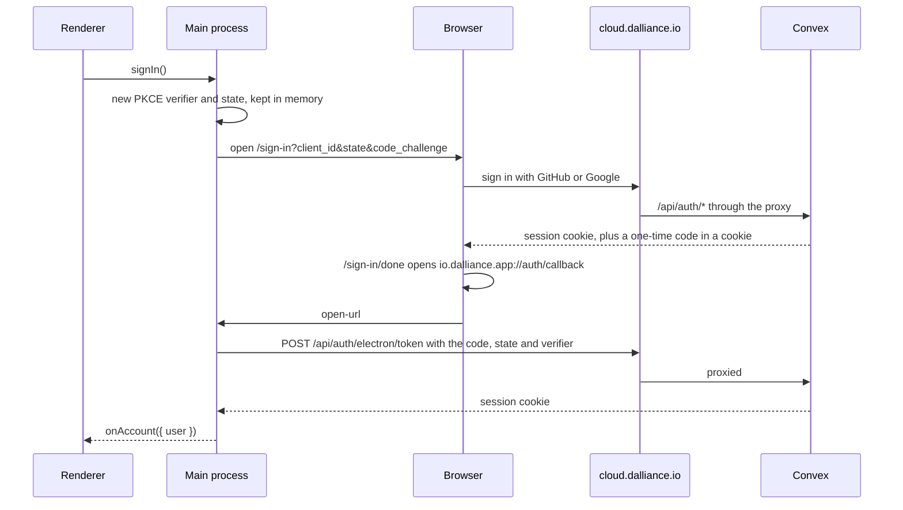

# Accounts

A Dalliance account is what runs models in the app. Every model call goes through Dalliance Cloud's proxy on the account's token, against its plan, so the app can't run a prompt without one. This page covers signing in, on the service's side. [billing.md](billing.md) covers the plan and the proxy, and [cloud.md](cloud.md) the app's side.

Three pieces take part:

| Piece | Code | Does |
| --- | --- | --- |
| Convex backend | `packages/backend/convex/` | Runs Better Auth and stores users, sessions and one-time codes |
| Cloud site | `apps/cloud/src/app/api/auth/`, `apps/cloud/src/app/sign-in/` | Proxies `/api/auth/*` to Convex, and hosts the sign-in page |
| Desktop app | The Cloud client in `apps/desktop/electron/cloud/`, see [cloud.md](cloud.md) | Holds the session in the main process and shows the account in Settings |

Better Auth is pinned to 1.6.x because `@convex-dev/better-auth` 0.12 needs it. The versions live in the catalog in `pnpm-workspace.yaml`, one for the whole repo, so the app's client and the backend's server always run the same one.

## Signing in



1. Settings calls `signIn()`. `Account.signIn()` calls the Electron plugin's `requestAuth()`. It makes a PKCE verifier and a state, keeps them in memory, and opens the sign-in page in the default browser with the challenge.
2. The sign-in page passes the desktop request along with every sign-in call as `fetchOptions.query`. After a successful sign-in, the Electron plugin's hook stores a one-time code tied to the challenge and puts it in the `better-auth.electron` cookie for two minutes.
3. `/sign-in/done` reads that cookie on the server, then `ensureElectronRedirect()` sends the browser to `io.dalliance.app://auth/callback#token=<code>`.
4. macOS hands the URL to the app. The plugin's `open-url` handler posts the code with the state and the verifier to `/electron/token`, which checks the verifier against the challenge and creates a session.
5. The new session cookie refetches the session. `Account` maps it to an `AccountView` and sends it to the renderer.

A browser that is already signed in shows "Continue as" instead. It calls `/electron/transfer-user`, which issues a code the same way.

If the browser can't open the app, the done page also shows the code, and Settings has a field for it. `redeemSignInCode()` calls the plugin's `authenticate()`. It only works in the same app session that started the sign-in, because the verifier lives in memory.

## Security

- **The session never reaches the renderer.** The auth client runs in the main process only. The renderer gets the name and email through `window.dalliance`. `setupMain()` runs with `bridges: false` and `csp: false`, so the plugin adds no `window.*` globals and leaves the packaged CSP alone.
- **The session is encrypted at rest.** The plugin encrypts every stored value with `safeStorage` before `fileStorage()` writes it to `account.json`. Without a keychain it keeps the session in memory only, so it's gone on relaunch.
- **Codes are one-time and bound to the app.** Redeeming one needs the PKCE verifier that only the main process holds. A wrong verifier or state consumes the code, so it can't be guessed at. A code expires after five minutes.
- **Deep links from anywhere are harmless.** Any page can open `io.dalliance.app://`, but a code only redeems with the verifier from this app's own pending sign-in. That also stops a site from signing the app into the attacker's account.
- **Every auth call goes through the cloud site.** The `proxyOnly()` plugin in `packages/backend/convex/auth.ts` answers 404 unless the request carries `AUTH_PROXY_SECRET` in `x-dalliance-proxy` (`PROXY_HEADER`). It fails closed: with the secret unset, nothing gets through. Only the JWKS stays public, because Convex and the model gateway fetch it to check tokens.
- **Rate limits count real addresses.** The proxy sets `x-dalliance-client-ip` (`CLIENT_IP_HEADER`) from Vercel's `x-real-ip`, which Vercel overwrites on every request, and drops any value the caller sent. Better Auth counts limits by it and stores them in the database, since Convex isolates share no memory.
- **Only two origins are trusted.** `trustedOrigins` holds `SITE_URL` and `io.dalliance.app:/`. The desktop client sends `electron-origin`, which the plugin turns into the origin header.
- **No passwords in production.** There's no email verification yet, and a billing account must belong to the email it shows. `PASSWORD_SIGN_IN=on` turns email and password on for local testing only.

## The patch

`patches/@better-auth__electron@1.6.33.patch`, at the repo root and applied through `patchedDependencies` in `pnpm-workspace.yaml`, lets the plugin's server half run on Convex. Upstream it imports `node:buffer` and `node:crypto` to compare the PKCE hash with `timingSafeEqual`, and Convex's default runtime has neither. The patch swaps them for a constant-time comparison on `Uint8Array`s. When you bump the plugin, check whether upstream still needs it. `pnpm install` fails loudly if the patch no longer applies.

The plugin's peers `@better-auth/utils` and `@better-fetch/fetch` are exact versions. Every package that uses the plugin lists them itself, from the catalog: `apps/desktop`, `apps/cloud` and `packages/backend`. Otherwise pnpm installs newer copies as peers and two copies of Better Auth's core end up in one bundle.

## Configuration

On the Convex deployment, set with `npx convex env set` from `packages/backend`:

| Variable | Used for |
| --- | --- |
| `BETTER_AUTH_SECRET` | Signs cookies and codes. `openssl rand -base64 32` |
| `SITE_URL` | The cloud site's origin, `https://cloud.dalliance.io` in production. Better Auth's base URL and a trusted origin |
| `AUTH_PROXY_SECRET` | Shared with the cloud site. `openssl rand -hex 32` |
| `GITHUB_CLIENT_ID`, `GITHUB_CLIENT_SECRET` | GitHub sign-in. Off unless both are set |
| `GOOGLE_CLIENT_ID`, `GOOGLE_CLIENT_SECRET` | Google sign-in. Off unless both are set |
| `PASSWORD_SIGN_IN` | `on` for email and password. Local deployments only |

The OAuth apps' callback URLs are `<SITE_URL>/api/auth/callback/github` and `<SITE_URL>/api/auth/callback/google`.

On the cloud site (Vercel), all read at request time, so they stay out of `turbo.json`:

| Variable | Used for |
| --- | --- |
| `CONVEX_SITE_URL` | The deployment's `.convex.site` URL. `/api/auth` proxies to it |
| `AUTH_PROXY_SECRET` | The same value as on Convex |
| `AUTH_METHODS` | The buttons the sign-in page shows: `github`, `google`, `password`. Defaults to `github,google`. Keep it in step with the providers Convex has credentials for |

The desktop app always talks to `https://cloud.dalliance.io`. A development build can point at another copy with `DALLIANCE_CLOUD_URL`, see [cloud.md](cloud.md#where-the-app-finds-it). What the app relies on is in [the contract](cloud.md#the-contract).

## Running it locally

Convex can run a local deployment without an account:

```bash
cd packages/backend
CONVEX_AGENT_MODE=anonymous npx convex dev
```

That serves the deployment on `127.0.0.1:3210` and its HTTP actions on `127.0.0.1:3211`, and writes both to `packages/backend/.env.local`. Log in with `npx convex login` to use a cloud deployment instead. Then, in another terminal:

```bash
cd packages/backend
npx convex env set BETTER_AUTH_SECRET "$(openssl rand -base64 32)"
npx convex env set SITE_URL http://localhost:3200
npx convex env set PASSWORD_SIGN_IN on
npx convex env set AUTH_PROXY_SECRET <secret>
```

Put the same secret in `apps/cloud/.env.local` with `CONVEX_SITE_URL=http://127.0.0.1:3211` and `AUTH_METHODS=password`. Start the site with `pnpm --filter @dalliance/cloud dev`, and point a development build of the app at it with `DALLIANCE_CLOUD_URL=http://localhost:3200` in `apps/desktop/.env`.

In development, the plugin registers the Electron binary itself as the handler for `io.dalliance.app`, so the deep link reaches `pnpm dev`. The packaged app registers the scheme through `protocols` in the electron-builder config.

## Gotchas

- **The callback path is exact.** The site opens `io.dalliance.app://auth/callback`. The plugin reads that as host `auth` and path `/callback`, and silently ignores anything else, including `io.dalliance.app:/auth/callback`.
- **Registering the scheme takes the single-instance lock.** A second copy of the app hands its URL to the first and calls `app.exit(0)`.
- **A stale deep link only logs.** A link whose sign-in was started before a relaunch has no verifier. The plugin's handler rejects it, the main process logs `Code verifier not found`, and Settings still offers Sign in.
- **Offline keeps the last user.** When the session check fails without a 401, `AccountView` keeps the user it had and sets `error`.

## What builds on it

The Convex JWT that `/api/auth/convex/token` issues is what `Billing` in the main process sends to Convex, and what the model proxy passes to `/gateway/authorize` for Convex to check. See [billing.md](billing.md). `auth:me` in `packages/backend/convex/auth.ts` returns the signed-in user from that token.
