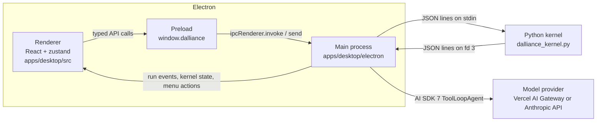
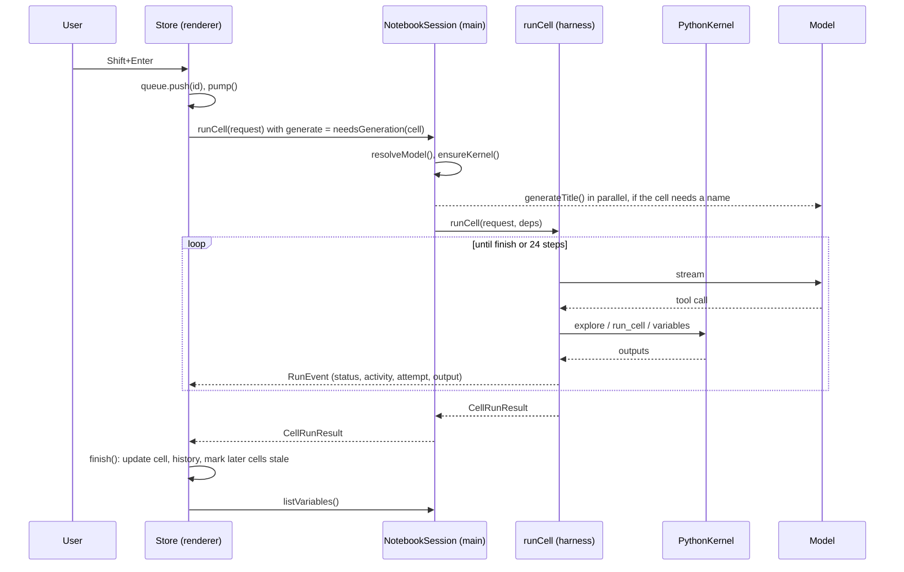

# Architecture

Dalliance runs as three processes on the user's machine. Nothing runs on a server except the model provider.



| Process | Code | Owns |
| --- | --- | --- |
| Renderer | `apps/desktop/src/` | The open notebook, the run queue, live run state, layout, every pixel |
| Main | `apps/desktop/electron/` | Files and dialogs, settings and keys, the agent loop, the kernel's lifecycle |
| Kernel | `apps/desktop/electron/kernel/dalliance_kernel.py` | One Python namespace that lives across cells |

The renderer holds the document. The main process holds everything with side effects. The kernel holds Python state. `packages/shared` holds the types that cross those lines.

## What happens when a cell runs



Step by step:

1. `actions.run(id)` in `src/store/notebook-store.ts` adds the cell to a module-level queue and marks it `queued`.
2. `pump()` takes one cell at a time. It decides `generate` with `needsGeneration()` from `packages/shared/src/notebook.ts` and builds a `RunCellRequest` with every earlier cell as context.
3. `window.dalliance.runCell()` goes over IPC to `NotebookSession.runCell()` in `electron/session.ts`.
4. The session resolves the model when the cell needs generating, starts the kernel if needed, fires off a title request, and calls `runCell()` in `electron/harness/run-cell.ts`.
5. With `generate: false` the harness runs the saved code once on the kernel. No model call.
6. With `generate: true` a `ToolLoopAgent` runs until `finish` succeeds or it hits 24 steps. Tool calls and outputs stream to the renderer as `RunEvent`s.
7. The result returns through the same `invoke`. The store's `finish()` writes it into the cell, pushes a revision, marks later `done` cells `stale`, and refreshes the variable list.

Questions and approvals from the agent pause the loop. The session sends a `question` or `approval` event with a `requestId`, then waits on a promise in `pending`. The renderer answers with `respond(requestId, answer)`. Stop, restart and the end of a run resolve every pending promise with `null`, so nothing hangs.

## Package boundaries

```
@dalliance/shared   imported by both sides, no Node or DOM APIs
  notebook.ts       Cell, Output, Provenance, needsGeneration, parseInterpretation
  ipynb.ts          toIpynb, fromIpynb
  ipc.ts            DallianceApi, RunEvent, request and result types, IPC channel names
  leaked.ts         splitLeaked, leakedList: recovers tool markup a model wrote into text
  normalize.ts      normalizeOutputs, canonicalOutputs: outputs without their run-to-run noise, for hashing and comparing

apps/desktop/electron   Node and Electron only, never imported by src/
apps/desktop/src        DOM only, never imports electron/
```

`@dalliance/shared` has no build step. Its `package.json` `exports` point at `.ts` files and Vite bundles them into the renderer, main and preload builds.

## Security model

The renderer is treated as untrusted web content.

- `contextIsolation: true`, `sandbox: true`, `nodeIntegration: false` in `electron/main.ts`.
- `electron/preload.ts` exposes one object, `window.dalliance`, and never `ipcRenderer` itself. Sandboxed preloads must be CommonJS, so Vite writes `preload.cjs`.
- Links with `https://` open in the default browser. Every other new window is denied, and in-app navigation is blocked.
- The main process answers IPC only from the top frame of its own window showing the app's own page. See [ipc.md](ipc.md#who-may-call).
- Packaged builds get a strict Content Security Policy from the `dalliance-csp` plugin in `vite.config.ts`. The dev server skips it because React Fast Refresh needs inline scripts.
- API keys are encrypted with Electron `safeStorage`, which uses the macOS keychain. See [storage.md](storage.md).
- In builds with Dalliance Cloud, the account's session and tokens stay in the main process too. The renderer only sees the name, email and plan. See [cloud.md](cloud.md#security).
- File paths from the renderer aren't trusted. `saveNotebook()` only writes to an absolute path ending in `.ipynb` and shows the Save dialog for anything else. `openRecent()` only opens a path already in `settings.recent`.

The agent is fenced in by the harness rather than by the OS:

- `read_file` and `list_files` refuse paths outside the workspace.
- Broad folders such as the home folder, Documents, Desktop, Downloads and iCloud Drive get no file listing at all. See `isBroadFolder()` in `electron/harness/workspace.ts`.
- A built-in event bus extension blocks `read_file` on `.env` and `.env.*`, in any case and with either `/` or `\` separators. See `isSecretPath()` in `electron/harness/code-policy.ts`.
- Package installs need the user's approval unless the approval mode is `background`.
- A code policy reads the Python that `explore` and `run_cell` are about to run. Code that reads secret files (`.env`, `~/.ssh`, `~/.aws`, `.netrc`, the keychain) is blocked. Code that runs shell commands or subprocesses, or uses the network, goes through the same approval as package installs. See `inspectCode()` in `electron/harness/code-policy.ts` and `codePolicy()` in `electron/harness/extensions.ts`.
- The code policy only reads the code's text, so it's a speed bump, not a sandbox. Code that hides what it does, or a library that fetches a URL on its own, gets through. Treat the kernel as having the user's permissions.

## Where state lives

| State | Lives in | Survives |
| --- | --- | --- |
| The notebook document | Renderer store, mirrored to the main process as a draft | Window reload and relaunch. See [storage.md](storage.md#session-and-drafts) |
| Live run state (`runs`, activity, questions) | Renderer store | Nothing. A reload interrupts the running cell |
| Python variables | Kernel process | Window reload. Not a relaunch or a restart |
| Settings and keys | `settings.json` in userData | Everything |
| Layout, sidebar open | `localStorage` in the renderer | Relaunch |
| Package trust for installs | `NotebookSession.trust` | The app session |
