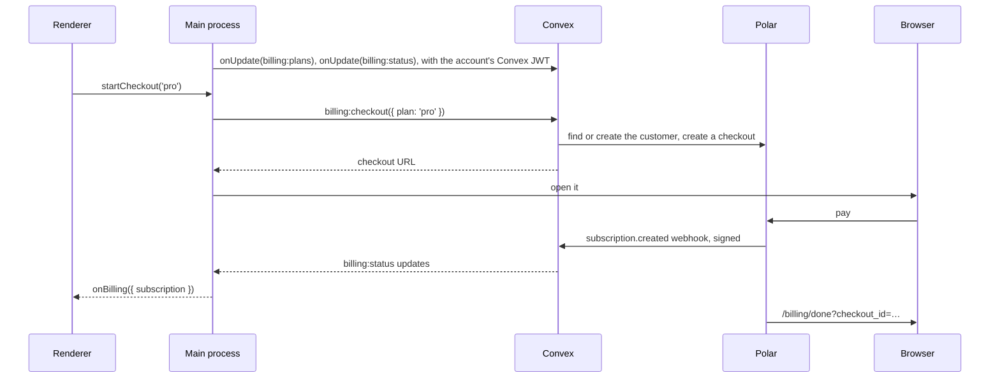
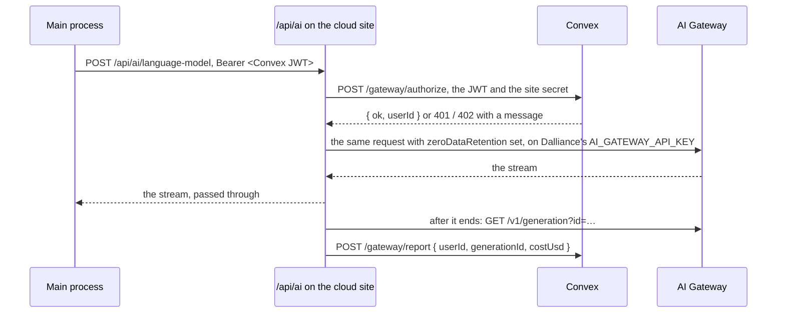

# Billing

A signed-in user can subscribe to a plan. Polar is the merchant of record: it runs checkout, charges the card, handles sales tax and sends invoices. Convex keeps a copy of each subscription from Polar's webhooks, and the app reads it live. Signing in comes first, see [accounts.md](accounts.md).

The plan is what runs the models. It includes a number of credits each billing period. Every model call the app makes goes through a proxy on the cloud site that checks the plan, calls Vercel AI Gateway on Dalliance's key with zero data retention, and counts what the call cost against the plan's credits. See [Models](#models) and [Zero data retention](#zero-data-retention).

| Piece | Code | Does |
| --- | --- | --- |
| Convex backend | `packages/backend/convex/billing.ts` | The plans on offer, the user's subscription, checkout and the billing portal. Polar's webhooks land in `http.ts` |
| Usage ledger | `packages/backend/convex/usage.ts`, `schema.ts` | The credit check before each model call, what each call cost, and the credits of a run for the app |
| Model proxy | `apps/cloud/src/app/api/ai/[...path]/route.ts` | Checks the plan, calls the gateway on Dalliance's key, records the cost |
| Zero data retention | `apps/cloud/src/lib/zdr.ts` | Which models qualify, and the flag every call carries |
| Desktop app | The Cloud client in `apps/desktop/electron/cloud/`, see [cloud.md](cloud.md) | A Convex client in the main process that follows the plan, and opens checkout and the portal in the browser. Settings shows the plan and its credits, and with Show costs on the Activity pane shows each run's |
| Cloud site | `apps/cloud/src/app/billing/done/` | Where Polar sends the browser after checkout or the portal |

## Subscribing



1. `Billing` in the main process holds a `ConvexClient` for the deployment's `.convex.cloud` URL. It subscribes to `billing:plans` and `billing:status`, and follows the account: signed in, its token fetcher calls `Account.convexToken()`, which gets a 15-minute Convex JWT from `/api/auth/convex/token` with the session cookie. Signed out, the fetcher returns null.
2. Subscribe calls `billing:checkout` with a plan key. The action looks up the product id for that key, finds or creates the Polar customer for the user, and returns a checkout URL. The main process opens it in the default browser.
3. After payment, Polar posts `subscription.created` to `/polar/events` on the deployment's `.convex.site` URL. The component checks the signature with `POLAR_WEBHOOK_SECRET` and stores the subscription. `billing:status` reruns, and the app gets the plan without polling.
4. Polar sends the browser to `/billing/done`. That page only says so. Its button opens `io.dalliance.app://billing`, which focuses the app.

Manage billing calls `billing:portal`, which returns a Polar customer portal session for the user: invoices, the card, cancelling. Cancelling arrives the same way, as `subscription.updated` with `cancelAtPeriodEnd`.

## Models



1. The app's gateway client points at `<site>/api/ai` and sends the account's Convex JWT as its key.
2. The proxy only serves `language-model` and `config`, the model list. For a model call it asks `/gateway/authorize` on Convex, passing the JWT and `AUTH_PROXY_SECRET`. Convex reads the user from the JWT and checks their plan: an active or trialing subscription, and credits left this period. The model list only needs a sign-in.
3. It refuses a model that doesn't qualify for zero data retention, sets the gateway's `zeroDataRetention` flag on the call, and sends it to `ai-gateway.vercel.sh/v4/ai/…` with Dalliance's key. It streams the answer back while keeping a copy. The model list comes back with only the qualifying models in it. See [Zero data retention](#zero-data-retention).
4. After the response, in `after()`, it finds the generation id in the copy and asks the gateway's `GET /v1/generation` for its `total_cost`. That record lands a few seconds after the call ends, so it retries on 404 for up to 30 seconds. Then it posts the cost to `/gateway/report`.
5. `usage:record` adds a row to `usage`, keyed by generation id so a repeat can't bill twice, and adds the cost to the user's `spend` row for the period. `billing:status` returns it, so Settings > Plan shows it live.
6. With Show costs on, the app asks `usage:credits` for the generation ids of each run it just made, and shows "counting" until every row has landed. The query is live, so each row reaches the app as it's recorded. See [Credits per run](#credits-per-run).

Users see credits, and the ledger keeps dollars. Each call's cost is stored exactly, in millionths of a dollar, as the gateway reported it. `CREDITS_PER_USD` on the deployment says how many credits a dollar of that cost uses, 100 unless set, so a credit is a cent of model use. A plan's credits per billing period are `POLAR_<PLAN>_CREDITS`, per plan key. Changing the rate reprices usage from then on, including what's already been spent this period, because the conversion happens when the totals are read. A period is the subscription's `currentPeriodStart`, so the total starts again when Polar renews it.

Refusals come back in the gateway's error shape with the type `dalliance_account`, so the AI SDK shows the message as written. `authentication_error` would be replaced with the SDK's own text about API keys. Running out of credits is a 402, not a 429, because a 429 is retried and waiting won't help.

## Credits per run

The app has a Show costs setting, off by default. It shows the credits each cell run used, never dollars, and a running total for the notebook.

The app knows each call's generation id: the gateway puts it in the call's provider metadata, which the proxy passes through. It subscribes to `usage:credits` with a run's ids and stops once every id has a row, or after 90 seconds. That's longer than the proxy's 30 seconds of retries for the cost, so a row that never comes means the call wasn't billed.

`usage:credits` reads the user from the Convex JWT and returns only that user's rows, whatever ids are sent, so one user can't see what another's calls cost. It takes at most 100 ids, more than a run makes. Credits come from `toCredits()` at the current `CREDITS_PER_USD`, like the period's total.

## Zero data retention

Every model call runs with zero data retention. The app has no other route to a model, so this covers all of them. It isn't a setting, and the app can't turn it off: the proxy enforces it, whatever the app sends.

It holds because of two things the proxy does, in `apps/cloud/src/lib/zdr.ts`:

1. **Only models with a zero-data-retention provider are offered.** The gateway's public `GET /v1/models` gives each model a `zdr` of `all`, `some` or `none`. The proxy keeps the ids with `all` or `some`, refreshed every ten minutes. `GET /api/ai/config` returns the gateway's model list filtered to those, and a call to any other model, or with a gateway fallback (`providerOptions.gateway.models`) to one, is refused with 403 before it reaches the gateway. The SDK's `getAvailableModels()` drops the `zdr` field, which is why the proxy reads `/v1/models` itself.
2. **Every call carries the flag.** The proxy parses each `language-model` call and sets `providerOptions.gateway.zeroDataRetention` to `true`, overwriting what the app sent. The gateway then routes the call only to providers with a zero-data-retention agreement, so a `some` model runs on its qualifying providers only.

A refresh of `/v1/models` that fails keeps the last list. If the list hasn't loaded once since the site started, every model call and the model list get 502, rather than running without the check.

**The gateway only allows it on a paid Vercel plan.** On a Hobby team the gateway refuses every call carrying the flag with 403 `ZdrUnauthorizedError`. The proxy turns that into a 503 that says hosted models aren't available, rather than letting the app read it as a rejected key, and logs `gateway refused zero data retention`. The fix is on Vercel: the team that owns `AI_GATEWAY_API_KEY` needs a Pro or Enterprise plan.

**Before that, `ZERO_DATA_RETENTION=off` on the cloud site sends calls without the flag**, so a deployment on a Hobby team can still run models while it's being built. Only the exact value `off` does it; anything else, or unset, keeps the flag. The model list is still filtered, so it matches what production offers. The site logs a warning when it starts with it off. It must never be set in production: the product promises zero data retention, and the app says so.

Zero data retention is not a HIPAA business associate agreement.

## Security

- **The app never picks a product or a destination.** `billing:checkout` takes a plan key, validated as a literal, and maps it to a product id from the deployment's environment. The success URL is built from `SITE_URL` on the server. The component's own `api()`, which takes product ids and URLs from the caller, isn't exported.
- **Only a verified email can reach a Polar customer.** Polar links a new customer to an existing one with the same email, and so to that customer's portal. `billingUser()` refuses unverified emails when `POLAR_SERVER` is `production`. GitHub and Google sign-in give verified emails. Sandbox allows unverified ones, so the local password sign-in can test checkout.
- **Subscriptions only come from Polar.** Nothing the app sends can write one. Webhooks with a bad signature get 403, and with `POLAR_WEBHOOK_SECRET` unset every webhook fails.
- **Each user sees only their own plan and usage.** `billing:status`, `billing:portal` and `usage:credits` read the user from the Convex JWT, never from arguments. `syncProducts` is internal, so only the CLI or the dashboard can run it.
- **The Convex token stays in the main process**, like the session.
- **Dalliance's gateway key only lives on the cloud site.** The proxy forwards only the request's content type, user agent, protocol version and `ai-language-model-*` headers, never the caller's cookies or token, and passes back no `set-cookie`.
- **Convex decides who pays.** The proxy bills the `userId` that `/gateway/authorize` returned for that JWT, never anything the app sent. `/gateway/authorize` and `/gateway/report` answer 404 without `AUTH_PROXY_SECRET`, so only the cloud site can ask or report. A JWT that Convex can't validate counts as signed out.
- **A cut-off call is still billed.** The proxy doesn't pass the caller's abort on to the gateway. The gateway charges for a stream the client stopped reading, so the call runs to the end and gets recorded. Otherwise stopping just before the end would be free.
- **The proxy never logs request or response bodies.** Its logs name the user, model and generation id only. Keep it that way: a logged prompt would break zero data retention on Dalliance's side.
- **Raw Convex errors never reach the app.** The proxy passes on Convex's messages for sign-in and plan problems and turns anything else into "Couldn't check your plan".

## Configuration

On the Convex deployment, besides the variables in [accounts.md](accounts.md#configuration):

| Variable | Used for |
| --- | --- |
| `POLAR_ORGANIZATION_TOKEN` | An organization access token from Polar. Sandbox and production have separate ones |
| `POLAR_WEBHOOK_SECRET` | The secret of the webhook endpoint in Polar |
| `POLAR_SERVER` | `sandbox` or `production`. Defaults to `sandbox` |
| `POLAR_PRODUCT_PRO` | The Polar product id behind the `pro` plan |
| `POLAR_PRO_CREDITS` | Credits the `pro` plan includes per billing period. Unset, calls are refused with "Credits aren't set up" |
| `CREDITS_PER_USD` | Credits a dollar of model cost uses. Defaults to 100, a cent a credit |

On the cloud site, besides `CONVEX_SITE_URL` and `AUTH_PROXY_SECRET`: `AI_GATEWAY_API_KEY`, Dalliance's own AI Gateway key, and `CONVEX_URL`, the deployment's `.convex.cloud` URL, which `/api/config` gives the app. Without them, `/api/ai` and `/api/config` answer 503. `ZERO_DATA_RETENTION=off` is only for a team without a paid Vercel plan, and never for production, see [Zero data retention](#zero-data-retention).

The webhook endpoint in Polar is `<CONVEX_SITE_URL>/polar/events`, in the Raw format, which Polar signs the Standard Webhooks way, with at least the `subscription.*` and `product.*` events. Polar must be able to reach it, so a local deployment on `127.0.0.1` can't receive webhooks. Use a cloud dev deployment for billing.

Products reach Convex through `product.created` and `product.updated` webhooks. For products made before the webhook, copy them once, from `packages/backend`:

```bash
npx convex run billing:syncProducts
```

The desktop app calls the backend through `cloudApi` in `packages/shared/src/cloud-api.ts`, typed with the shapes in `packages/shared/src/cloud.ts`, and the backend's handlers return those same types. `packages/backend/contract.ts` fails typecheck when a function the app calls no longer matches. See [the contract](cloud.md#the-contract).

## Trying it in the sandbox

1. Create an organization on sandbox.polar.sh and a monthly recurring product.
2. Create an organization access token, and a webhook to `<CONVEX_SITE_URL>/polar/events` with the subscription and product events.
3. Set the variables above on a cloud dev deployment, including the plan's credits, and run `billing:syncProducts`.
4. Put `AI_GATEWAY_API_KEY` in `apps/cloud/.env.local`.
5. Point the cloud site's `CONVEX_SITE_URL` and `CONVEX_URL` at that deployment, set `DALLIANCE_CLOUD_URL=http://localhost:3200` in the app's `apps/desktop/.env`, sign in, and subscribe from Settings > Plan with Polar's test card, `4242 4242 4242 4242`.
6. Run a cell. The credits it used show under Settings > Plan a few seconds after it finishes.

## Gotchas

- **`@polar-sh/sdk` stays on 0.x.** 1.0 changed its package exports, and `@convex-dev/polar` 0.9 imports paths 1.0 no longer has. Convex fails to bundle with `Could not resolve "@polar-sh/sdk/core.js"`.
- **Webhook signing changed on 8 September 2026, and a patch covers it.** Endpoints made since then sign with the Standard Webhooks key, the base64 after `whsec_`. Older ones sign with the UTF-8 bytes of the whole secret. SDK 1.x tries both, 0.x only the older one, so every delivery failed with `No matching signature found`. `patches/@convex-dev__polar@0.9.2.patch` adds `validatePolarEvent()`: when the older check fails and the secret starts with `whsec_`, it checks the signature with the Standard Webhooks key, then signs the same body under the older key so the SDK parses it as before. A wrong key still gets 403. Drop the patch once the component supports SDK 1.x.
- **The webhook's API version shapes the payloads**, and SDK 0.49 predates 2026-10. A delivery that passes the signature but fails with `SDKValidationError` in the Convex logs means the payload shape is newer than the SDK. Pick an older API version on the endpoint.
- **A period can end slightly over.** The check happens before a call and the cost is known after, so the call that uses the last credits runs to the end. Calls made at the same time can each cross it. The next call after that is refused.
- **A call without a generation id or a cost isn't billed.** The proxy logs `not billed` with the user and model. Watch the cloud site's logs for it.
- **One active subscription per user.** The component's `getCurrentSubscription` expects at most one subscription without an end date. Upgrades should change the plan in place rather than start a second one.
