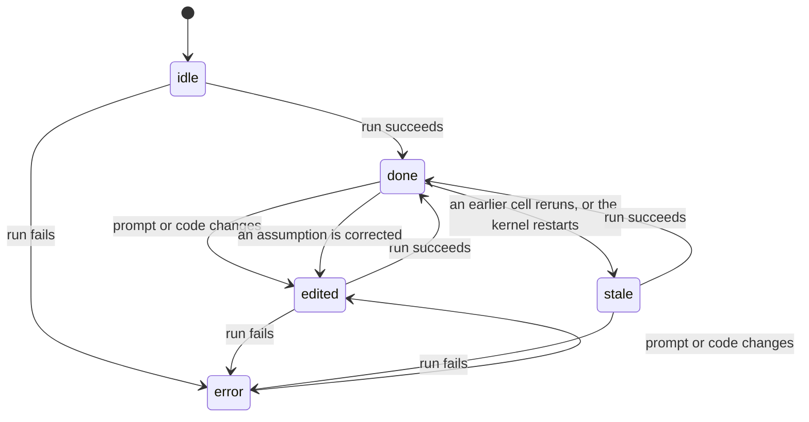

# The notebook model

The types live in `packages/shared/src/notebook.ts`. Both the renderer and the main process use them, and they map closely onto nbformat 4.

## Cells

A notebook is `{ cells: Cell[] }`. A cell is either a note or a prompt.

```ts
type Cell = PromptCell | NoteCell
```

A `NoteCell` holds Markdown and nothing else.

A `PromptCell` carries more. The fields that drive behaviour:

| Field | What it's for |
| --- | --- |
| `prompt` | What the user wrote |
| `code` | The Python that runs. Written by the agent or by the user |
| `generatedFrom` | The prompt text `code` was written for. A different prompt means regenerate |
| `codeEdited` | True once the user edits `code` by hand. Stops regeneration until the prompt changes |
| `interpretation` | The agent's reading, with assumptions in `[[double brackets]]` |
| `corrections` | `{ from, to }` pairs the user made to assumptions |
| `answer` | Prose answer, Markdown with only `**bold**` and `` `code` `` |
| `suggestions` | Up to three follow-up prompts |
| `history` | Earlier working versions, newest first, at most `MAX_REVISIONS` = 12 |
| `outputs` | The last run's outputs |
| `variables` | Names the last successful run assigned, for `@name` references |
| `title`, `titleFrom` | A short name from the small model, and the prompt it was written for |
| `showTables` | The user's fold choice for tables. `null` lets `tablesOpen()` decide |
| `state` | See below |

## Outputs

```ts
type Output =
  | { type: 'stream'; name: 'stdout' | 'stderr'; text }
  | { type: 'text'; text }                      // repr() of the last expression
  | { type: 'table'; columns; index; rows; totalRows; profile? }
  | { type: 'image'; mime: 'image/png'; data }  // base64
  | { type: 'error'; ename; evalue; traceback }
```

The kernel sends at most 100 table rows. `totalRows` has the real count. `profile` is a per-column summary with dtype, missing count, distinct count, range or top values. See [kernel.md](kernel.md#tables-and-column-profiles).

## Cell states

`running` and `queued` are not states. They live in the renderer's `runs` map and are never saved.



Opening a file puts every cell that has outputs or an execution count into `stale`, since the kernel that made them is gone.

## Generate or just run

`needsGeneration(cell)` decides whether the agent writes code or the saved code runs as is, the way a Jupyter cell reruns. It checks in this order:

1. No code and a non-empty prompt: generate.
2. Any corrections: generate.
3. The user edited the code: run it.
4. `generatedFrom` is `null`: run it. That covers plain Jupyter cells and code the user typed into a fresh cell.
5. Otherwise, generate when the trimmed prompt differs from `generatedFrom`.

A few actions set these fields on purpose:

- `regenerate(id)` sets `generatedFrom: ''` and `codeEdited: false`, then runs. The prompt no longer matches, so the agent rewrites the code.
- A failed generation stores `generatedFrom: ''` too, so the next run tries again instead of rerunning broken code.
- A successful generation clears `corrections`.
- `restoreRevision()` puts back the revision's prompt and code with `generatedFrom` equal to that prompt, so the restored code runs without the model.

## After a run

`finish()` in `src/store/notebook-store.ts` applies a `CellRunResult`:

- A result for a cell that was deleted while it ran, or whose notebook was replaced by another, is dropped. No cell changes, even one Undo brought back. See [renderer.md](renderer.md#the-run-queue).
- If nothing ran at all, meaning no execution count, no outputs and not ok, the cell stays as it was and the error shows as a message. That's the path for a missing key, a missing Python, or Stop before any code ran.
- Otherwise the cell takes the result's code, outputs, count and duration, and its state becomes `done` or `error`.
- A successful run pushes a revision unless the top one has the same prompt and code.
- A successful run marks every later `done` prompt cell `stale`.
- Errors that aren't Python errors go into `messages[cellId]` and show under the prompt.

## Titles

Long prompts get a 2 to 5 word title for the overview. The store asks for one when the prompt is at least `MIN_TITLE_PROMPT` = 16 characters and `titleFrom` doesn't match it. The title arrives as a `title` run event, possibly after the run ends, and goes straight onto the cell. `cellTitle()` in `src/lib/notebook/text.ts` shows the title only while `titleFrom` still equals the prompt. The model side is in [agent-harness.md](agent-harness.md#titles).

## Saving as .ipynb

`packages/shared/src/ipynb.ts` converts both ways.

`toIpynb()` writes nbformat 4.5:

- Note cells become `markdown` cells.
- Prompt cells become `code` cells. `source` is the Python, so Jupyter can run the file.
- Everything else about a prompt cell goes under `metadata.dalliance`: `prompt`, `title`, `titleFrom`, `generatedFrom`, `codeEdited`, `interpretation`, `answer`, `suggestions`, `history`, `variables`, `showTables`, `state`, `durationMs`.
- Tables are saved as `display_data` with the custom MIME type `application/vnd.dalliance.table+json` and a `text/plain` fallback.
- The notebook's metadata carries `dalliance: { version: FORMAT_VERSION }`, which is 1 today.

`fromIpynb()` reads any nbformat 4 file:

- `markdown` and `raw` cells become notes.
- `code` cells become prompt cells. A plain Jupyter cell has no prompt and keeps its code, so it runs without the agent.
- Outputs map back by MIME type in this order: the Dalliance table type, `image/png`, `text/plain`. A pandas HTML table from Jupyter shows as its `text/plain` fallback. An output with none of the three is dropped.
- `corrections` are not saved. They only live until the next run.
- `state` is not read back. A cell opens as `stale` or `idle`, as described above.
- Every field under `metadata.dalliance` is type-checked. A field with the wrong type reads as its default: `null`, `[]` or `false`. A mistyped `generatedFrom` reads as missing, so the saved code counts as written for its prompt.
- Lists are filtered item by item. A revision without string `code` is dropped, and a variable without a string `name` is dropped. Other missing revision fields get defaults.
- Cells and outputs that aren't objects are skipped. A malformed table keeps the parts that parse.
- The version check comes first. A missing or non-numeric `metadata.dalliance.version` reads as 1. A number above `FORMAT_VERSION` throws "This notebook was saved by a newer version of Dalliance. Update the app to open it." Opening the file fails with that message instead of loading fields the app would misread.

Change the format with care. Old files must still open, so add fields with defaults and read them with the type guards in `ipynb.ts`, never with a bare cast. Bump `FORMAT_VERSION` only for a change old readers can't handle. Once it's bumped, older apps refuse the new files.

## Interpretation and corrections

`parseInterpretation()` splits `"Churned means [[cancelled within 14 days]]."` into plain and assumption segments. The renderer underlines assumptions. Clicking one opens an inline input. On blur, `correctAssumption()` swaps the bracketed text, records `{ from, to }`, and sets the cell to `edited`. The next run sends `corrections` to the agent, which sees them as `Not "from". Use: "to"` in the cell prompt.
