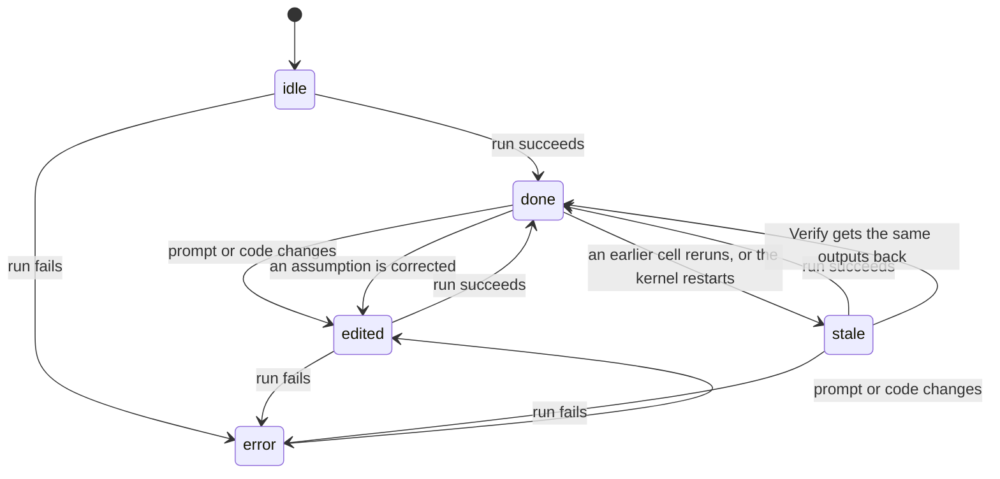

# The notebook model

The types live in `packages/shared/src/notebook.ts`. Both the renderer and the main process use them, and they map closely onto nbformat 4.

## Cells

A notebook is `{ cells: Cell[], metadata?, pins? }`. A cell is either a note or a prompt. `metadata` is the file's notebook metadata, carried through for Jupyter (see [Passthrough](#passthrough)). `pins` is the Python, the packages and the data files the cells ran with, recorded on save (see [Pins](#pins)). The renderer never reads `metadata` and keeps both by spreading the notebook.

```ts
type Cell = PromptCell | NoteCell
```

A `NoteCell` holds Markdown. Like a prompt cell, it may also carry an optional `jupyter` field with what the file had that Dalliance doesn't use.

A `PromptCell` carries more. The fields that drive behaviour:

| Field | What it's for |
| --- | --- |
| `prompt` | What the user wrote |
| `attachments` | Files the user dropped on the cell, as paths inside the notebook's folder, usually `uploads/…`. Saved only when there are any |
| `code` | The Python that runs. Written by the agent or by the user |
| `generatedFrom` | What `code` was written for, from `generationKey()`: the prompt, plus the attached files when there are any. A different one means regenerate |
| `codeEdited` | True once the user edits `code` by hand. Stops regeneration until the prompt changes |
| `interpretation` | The agent's reading, with assumptions in `[[double brackets]]` |
| `corrections` | `{ from, to }` pairs the user made to assumptions |
| `answer` | Prose answer, Markdown with only `**bold**` and `` `code` `` |
| `suggestions` | Up to three follow-up prompts |
| `history` | Earlier working versions, newest first, at most `MAX_REVISIONS` = 12 |
| `outputs` | The last run's outputs |
| `variables` | Names the last successful run assigned, for `@name` references |
| `title`, `titleFrom` | A short name from the selected model, and the prompt it was written for |
| `showTables` | The user's fold choice for tables. `null` lets `tablesOpen()` decide |
| `state` | See below |
| `provenance` | How the agent made the code: the record of the last generation, or `null`. See [How a cell was made](#how-a-cell-was-made) |
| `jupyter` | Optional. What the file had that Dalliance doesn't use. Only `ipynb.ts` reads it. See [Passthrough](#passthrough) |

## Outputs

```ts
type Output =
  | { type: 'stream'; name: 'stdout' | 'stderr'; text }
  | { type: 'text'; text }                      // repr() of the last expression
  | { type: 'table'; columns; index; rows; totalRows; profile? }
  | { type: 'image'; mime: 'image/png'; data; width?; height? }  // base64; the size to show it at, in CSS pixels
  | { type: 'error'; ename; evalue; traceback }
```

The kernel sends at most 100 table rows. `totalRows` has the real count. `profile` is a per-column summary with dtype, missing count, distinct count, range or top values. See [kernel.md](kernel.md#tables-and-column-profiles).

## Cell states

`running` and `queued` are not states. They live in the renderer's `runs` map and are never saved.



Opening a file puts every cell that has outputs or an execution count into `stale`, since the kernel that made them is gone. A Verify rerun only ever moves a cell from `stale` to `done`, when it gives back the outputs the cell shows. See [Verifying a notebook](#verifying-a-notebook).

## Generate or just run

`needsGeneration(cell)` decides whether the agent writes code or the saved code runs as is, the way a Jupyter cell reruns. It checks in this order:

1. No code and a non-empty prompt, or an attached file: generate.
2. Any corrections: generate.
3. The user edited the code: run it.
4. `generatedFrom` is `null`: run it. That covers plain Jupyter cells and code the user typed into a fresh cell.
5. Otherwise, generate when `generationKey(cell)` differs from `generatedFrom`, both trimmed. With no attachments the key is the prompt alone, so files saved before attachments existed still match. Attaching a file or taking one off changes the key, so the next run writes the code again. Restoring a revision keeps the cell's attachments and counts the restored code as written for them.

A few actions set these fields on purpose:

- `regenerate(id)` sets `generatedFrom: ''` and `codeEdited: false`, then runs. The prompt no longer matches, so the agent rewrites the code.
- A failed generation stores `generatedFrom: ''` too, so the next run tries again instead of rerunning broken code.
- A successful generation clears `corrections`.
- `restoreRevision()` puts back the revision's prompt and code with `generatedFrom` equal to that prompt, so the restored code runs without the model.

## After a run

`finish()` in `src/store/notebook-store.ts` applies a `CellRunResult`:

- A result for a cell that was deleted while it ran, or whose notebook was replaced by another, is dropped. No cell changes, even one Undo brought back. See [renderer.md](renderer.md#the-run-queue).
- If nothing ran at all, meaning no execution count, no outputs and not ok, the cell stays as it was and the error shows as a message. That's the path for a missing provider key, a missing Python, or Stop before any code ran. Failed app builds carry `appBuildError` and count as attempted work, so they clear the previous answer and outputs, mark the cell as failed, and retry generation on the next run.
- Otherwise the cell takes the result's code, outputs, count and duration, and its state becomes `done` or `error`. After a generation, `generatedFrom` is the prompt that was sent, not whatever the prompt box holds when the run ends.
- A generation also replaces `provenance` with the result's record, even when it failed, since the cell keeps the code it left. A plain run of saved code leaves `provenance` alone. See [How a cell was made](#how-a-cell-was-made).
- The user can keep typing while the agent works. `finish()` compares the cell with the version that was sent. If the prompt or the code changed meanwhile, those edits are kept over the result, the cell ends `edited` instead of `done` or `error`, and an edited code sets `codeEdited`. The next run then regenerates for the new prompt or runs the user's code.
- A successful run pushes a revision unless the top one has the same prompt and code. The revision is the version that ran, not the edits made meanwhile.
- A successful run marks every later `done` prompt cell `stale`.
- Errors that aren't Python errors go into `messages[cellId]` and show under the prompt.

## Titles

Long prompts get a 2 to 5 word title for the overview. The store asks for one when the prompt is at least `MIN_TITLE_PROMPT` = 16 characters and `titleFrom` doesn't match it. The title arrives as a `title` run event, possibly after the run ends, and goes straight onto the cell. `cellTitle()` in `src/lib/notebook/text.ts` shows the title only while `titleFrom` still equals the prompt. The model side is in [agent-harness.md](agent-harness.md#titles).

## Saving as .ipynb

`packages/shared/src/ipynb.ts` converts both ways.

`toIpynb()` writes nbformat 4.5:

- Note cells become `markdown` cells, or `raw` cells when they came from one.
- Prompt cells become `code` cells. `source` is the Python, so Jupyter can run the file.
- Everything else about a prompt cell goes under `metadata.dalliance`: `prompt`, `title`, `titleFrom`, `generatedFrom`, `codeEdited`, `interpretation`, `answer`, `suggestions`, `history`, `variables`, `showTables`, `state`, `durationMs`, and `provenance` when the cell has one, in its compact form (see [How a cell was made](#how-a-cell-was-made)).
- Tables are saved as `display_data` with the custom MIME type `application/vnd.dalliance.table+json` and a `text/plain` fallback.
- The notebook's metadata carries `dalliance: { version: FORMAT_VERSION }`, which is 1 today, and `pins` when the notebook has them. See [Pins](#pins).
- The kernelspec and `language_info` are the file's own, even for an R kernel. Only a notebook without a kernelspec gets Python 3, and then `language_info: { name: 'python' }` if it has none.
- Whatever the file had that Dalliance doesn't use goes back as it was found. See [Passthrough](#passthrough).

`fromIpynb()` reads any nbformat 4 file:

- `markdown` and `raw` cells become notes. A raw cell shows as a note and remembers it was raw.
- `code` cells become prompt cells. A plain Jupyter cell has no prompt and keeps its code, so it runs without the agent.
- Outputs map back by MIME type in this order: the Dalliance table type, `image/png`, `text/plain`. An image's `width` and `height` are saved as Jupyter's output metadata, `{ "image/png": { width, height } }`, so Jupyter shows a 2x figure at its size too. Reading, both must be positive whole numbers or neither is read, and an output with metadata Dalliance doesn't read is kept as found (see [Passthrough](#passthrough)). A pandas HTML table from Jupyter shows as its `text/plain` fallback. An output with none of the three isn't shown, but it isn't lost either: see [Passthrough](#passthrough).
- `corrections` are not saved. They only live until the next run.
- `state` is not read back. A cell opens as `stale` or `idle`, as described above.
- Every field under `metadata.dalliance` is type-checked. A field with the wrong type reads as its default: `null`, `[]` or `false`. A mistyped `generatedFrom` reads as missing, so the saved code counts as written for its prompt.
- Lists are filtered item by item. A revision without string `code` is dropped, and a variable without a string `name` is dropped. Other missing revision fields get defaults.
- `metadata.dalliance.pins` is read into `Notebook.pins` by `pinsFromNb()`. A package without a string `name` and `version`, or a file without a string `path` and a size of 0 or more, is dropped, and a file whose `hash` isn't a string reads as not hashed. Pins with nothing left read as none. At most `MAX_PINNED` = 1,000 packages and 1,000 files are read.
- `provenance` that isn't an object, or has no string `madeAt`, reads as `null`. Inside it the same rules hold: a mistyped field reads as its default, and an attempt without string `code`, a file without a string `path`, a step without a number, or an approval with an unknown `kind` or `outcome` is dropped.
- Cells and outputs that aren't objects are skipped. A malformed table keeps the parts that parse.
- The version check comes first. A missing or non-numeric `metadata.dalliance.version` reads as 1. A number above `FORMAT_VERSION` throws "This notebook was saved by a newer version of Dalliance. Update the app to open it." Opening the file fails with that message instead of loading fields the app would misread.

### Passthrough

Opening a colleague's notebook and saving it must not lose anything, so everything Dalliance doesn't understand is carried through unchanged. `fromIpynb()` records it in optional fields and `toIpynb()` merges it back. A notebook made in Dalliance has none of these fields.

| What | Kept in | Written back |
| --- | --- | --- |
| Notebook metadata: kernelspec, `language_info`, widget state, anything else | `Notebook.metadata`, minus `dalliance.version` and `dalliance.pins` | As found. `dalliance.version` is always `FORMAT_VERSION`, and `dalliance.pins` is the notebook's own |
| Cell metadata: tags, `jupyter.source_hidden`, `execution` timings, anything else | `cell.jupyter.metadata`, minus the keys Dalliance reads from `dalliance` | As found, with Dalliance's own fields under `metadata.dalliance` on top |
| Unknown keys under a cell's `metadata.dalliance`, from a newer Dalliance | `cell.jupyter.metadata.dalliance` | Under Dalliance's fields. Dalliance's win where they overlap, and a field Dalliance leaves out doesn't come back from the file |
| Attachments of a Markdown or raw cell | `cell.jupyter.attachments` | As found, even after the note is edited |
| That a note was a raw cell | `cell.jupyter.raw` | As a `raw` cell, with its metadata (`raw_mimetype` and so on) |
| The outputs of a code cell | `cell.jupyter.outputs` and `cell.jupyter.outputsFrom` | As found, until the cell reruns |

Outputs are the one passthrough that can go out of date. `fromIpynb()` keeps a cell's outputs as found only when writing Dalliance's own outputs back would lose something: an output it can't show (`text/html`, `image/svg+xml`, `image/jpeg`, `application/json`, a widget view...), another MIME type beside the one it reads, or output metadata. With them it records `outputsFrom`: the cell's execution count and a hash of the outputs Dalliance read. On save, `toIpynb()` writes the kept outputs, in their original order, while the cell's outputs still hash the same and its execution count is unchanged or `null`. Restarting Python clears the count and keeps the outputs, so they survive a restart. A rerun gives new outputs or a new count, and then only Dalliance's outputs are written, since the old HTML or widget view belongs to a run that no longer matches.

Anything that isn't valid in the first place is not carried: cells and outputs that aren't objects, and a kernelspec that isn't one. Converting a cell between prompt and note in the app makes a new cell, so it drops the passthrough. Files are always written as nbformat 4.5, so a 4.4 file gains cell ids on its first save.

Change the format with care. Old files must still open, so add fields with defaults and read them with the type guards in `ipynb.ts`, never with a bare cast. Bump `FORMAT_VERSION` only for a change old readers can't handle. Once it's bumped, older apps refuse the new files.

## How a cell was made

Every generation leaves a record on the cell, `PromptCell.provenance`. It's saved with the notebook for reproducibility and for Verify, which reads its attempts to explain a missing name. The UI doesn't show it. `buildProvenance()` in `electron/harness/provenance.ts` builds it when the run ends, and it comes back as `CellRunResult.provenance`. The types are in `packages/shared/src/notebook.ts`.

| Field | Holds |
| --- | --- |
| `prompt`, `corrections` | What the agent was given |
| `madeAt` | When the run ended, ISO 8601 |
| `model`, `effort` | What Settings chose |
| `steps` | `{ step, model }` for every model call: the model that answered |
| `rationale` | The agent's stated rationale, see below |
| `attemptCount`, `attempts` | Each `run_cell`: its `code`, its `error` in one line (`KeyError: 'plan'`) or `null`, and `changed`, the lines that differ from the attempt before as `- ` and `+ ` lines, at most 12. `changed` is `null` for the first attempt and empty for the same code again |
| `filesRead`, `filesReadTruncated` | Files inside the workspace, relative, `by: 'code'` when the final code read them and `by: 'agent'` for `read_file`, `explore` or an earlier attempt. At most 100 |
| `approvals` | `{ kind, detail, outcome }`: `kind` is `packages`, `shell`, `network` or `secret`, and `outcome` is `approved` (a person said yes), `trusted` (nobody was asked: background mode, or approved earlier in the session), `declined` or `blocked` (secret files, never allowed). Each answer once, at most 20 |
| `codeHash`, `outputsHash` | `sha256:<hex>` of the final code, and of `canonicalOutputs()` of its outputs |

**The stated rationale** is the model's reasoning summaries, one per step that had one, each clipped at 4,000 characters: `{ from: 'summaries', text }`. Adaptive thinking often skips easy steps, so at `medium` effort a run can have none. Then the record falls back to the cell's interpretation and answer, `{ from: 'interpretation', text }`, and the view says so. With neither, `from` is `none`. The UI calls it the agent's stated rationale, never its reasoning: a summary is what the model said about its steps, not a trace of how it got there.

**The file keeps it compact.** In memory the record holds every attempt of the run. `toIpynb()` writes only the last one, with `attemptCount` for the rest, and leaves out empty lists and a false `filesReadTruncated`. The whole trail, every tool call with its input and result, is in `logs/agent.jsonl` (see [storage.md](storage.md)). So after a save and reopen, or a window reload, the view says the earlier attempts are in the agent log.

**A plain rerun keeps it.** The record describes how the code was written, so a plain run of the saved code leaves it alone. When the cell's code no longer matches the final attempt, because the user edited it or restored a revision, the view says so and still shows the code the agent wrote. A cell from before the record existed, and a plain Jupyter cell, has `provenance: null`.

**Output hashes go through one normalizer.** `packages/shared/src/normalize.ts` takes out what changes from run to run without the result changing, so two runs of the same code hash the same:

| What | Becomes |
| --- | --- |
| Printed text split into several `stream` outputs, which depends on timing | One output per run of the same stream |
| Memory addresses, `0x` and six or more hex digits | `0x…` |
| The cell's number in a traceback: `<cell 3>`, `Cell In[3]`, `<ipython-input-3-…>` | The same without the number |
| `%time` and `%timeit` timings | `…` |
| Terminal colour codes, `\r\n` | Removed, `\n` |

Numbers, table values and images stay exact. `normalizeOutputs()` returns the outputs normalized, and `canonicalOutputs()` returns them as one JSON string with every object's keys sorted, which is what `outputsHash` hashes. Anything that compares a rerun with saved outputs must use these same functions, as [Verify](#verifying-a-notebook) does, so a change to the rules changes what counts as the same result everywhere at once.

The record is a new optional field that older apps don't read, so `FORMAT_VERSION` stays 1. An older app carries it through as an unknown key, even after it regenerates the code, and then `codeHash` and the final attempt no longer match the cell, which the view points out.

## Verifying a notebook

Verify checks that the notebook gives the same results from a clean start, the way a colleague opening the file would get them. It restarts the tab's kernel, the one it already has, so it needs no extra memory, then reruns every prompt cell's saved code top to bottom without the agent, and compares each result with what the cell had. The run side is in [renderer.md](renderer.md#verify). The comparison and the code checks are pure functions in `packages/shared/src/verify.ts`.

It asks first: "Verify restarts Python and re-runs every cell. Variables you created outside cells will be cleared."

**What reruns.** Every prompt cell with code, even one whose prompt changed since the code was written, since the saved code is what the file holds. Note cells are skipped. A prompt cell with no code, such as a question answered in words, is listed as having no code to run. No model is called, not even for a cell's name.

**How a result compares.** `compareOutputs()` puts both lists through `canonicalOutputs()`, so the normalizer's rules above decide what counts as the same. Text, tables and errors must then match exactly. Figures are compared byte for byte: the same bytes are the same, and anything else, with the same number of figures, is "figure differs". That isn't a failure: a plotting library can draw the same chart with different bytes, so the report shows the saved and new figures side by side for a person to judge. A different number of figures counts as changed.

| Result | Means |
| --- | --- |
| Same | Everything matches |
| Figure differs | Text and tables match, a figure isn't byte for byte the same |
| Changed | Text, a table or the number of figures differs. The report shows saved and new side by side |
| Failed | The rerun raised an error, or couldn't run |
| Stopped | Stop cut the rerun short |
| Not run | Verify ended before this cell, it was deleted meanwhile, or Python didn't restart |

**A name only the agent made.** The agent's `explore` runs in the same namespace as the cells (see [kernel.md](kernel.md#executing-code)), so a cell can work only because an explore call defined something. A restart clears it, and the cell then fails with a `NameError`. `missingNameCause()` says why, from the code's text and what the rerun assigned:

- a cell above that failed defines the name: the report points to it;
- only a cell below defines it: the cells are in the wrong order;
- code the agent ran outside the cells defines it: its explore calls and earlier attempts, from this session's activity and the cell's record. The report says the agent made it while working on that cell, so the cell only worked in the session it was written in;
- nothing known defines it: it came from outside the cells, most likely exploration in an earlier session.

When a cell above that ran does define the name, or might through `from x import *`, there's nothing to add. `definedNames()` reads assignments, `for` and `with` targets, `def`, `class`, imports and `:=`, and leaves out names inside a function or class body.

**Random calls with no fixed seed.** `seedWarnings()` reads each cell's code, with the cells above it for seeds and imports, and the report warns, whatever the result:

- NumPy's global functions, `np.random.choice()` and the like, with no `np.random.seed()` in or above the cell, and `default_rng()` or `RandomState()` made without a seed;
- the `random` module's functions, once it's imported, with no `random.seed()`, and `random.Random()` without a seed;
- scikit-learn estimators, splitters and helpers that take `random_state`, called without it or with `None`, in a notebook that uses `sklearn`. `KFold` and `StratifiedKFold` count only with `shuffle=True`, and `train_test_split` not with `shuffle=False`.

It stays quiet when in doubt: comments and strings don't count, a seed set anywhere above or in the cell counts, a generator made with a seed is fine wherever it's used, and a call passing `**kwargs` is left alone. It reads text, so `from random import choice` and seeds set some other way aren't seen. The wording says a call can give a different result, never that it did.

**What Verify does to the notebook.** Nothing a researcher saved changes on its own. Outputs, the record of how each cell was made, history, answers and code stay as they were. The restart does what any restart does: cells that ran lose their execution count and go `stale`. A cell whose rerun came back the same goes back to `done` with its new count, since what it shows is what the kernel now holds; a cell with outputs kept from Jupyter (see [Passthrough](#passthrough)) keeps no count, so those outputs still save. A cell that changed stays `stale` and keeps its saved outputs. The report's Keep the new outputs, on a changed cell or one whose figure differs, is the only way the rerun's outputs replace the saved ones. It's one cell at a time, and Undo puts the saved outputs back. The report itself isn't saved.

**Before Verify.** `beforeVerify()` in the store runs once the user confirms and before Python restarts. It checks the notebook's [pins](#pins) against this machine with `actions.checkPins()`, so the banner says what differs, like a newer pandas or a changed data file, before the rerun shows what that changed. It waits 5 seconds at most (`PIN_CHECK_MS`), since the check may be hashing a changed file, and Verify goes ahead even if it throws.

## Pins

A saved notebook records what its cells ran with, so a colleague, or the same person a year later, can tell whether a rerun should give the same results. `Notebook.pins` holds it, and the file keeps it under the notebook's `metadata.dalliance.pins`:

```json
"metadata": {
  "dalliance": {
    "version": 1,
    "pins": {
      "python": "3.12.4",
      "packages": [
        { "name": "numpy", "version": "2.1.3" },
        { "name": "pandas", "version": "2.2.3" }
      ],
      "files": [
        { "path": "data/visits.csv", "size": 48213, "hash": "sha256:9f86d081884c7d65…" },
        { "path": "imaging/all.parquet", "size": 2147483648, "hash": null, "note": "Not hashed: larger than 1 GB." }
      ]
    }
  }
}
```

| Field | Holds |
| --- | --- |
| `python` | The kernel's Python version. `null` until a kernel has run the cells |
| `packages` | The distributions the cells imported and the loaded ones they require, by `importlib.metadata` name, sorted. The standard library is left out. See [kernel.md](kernel.md#imported-packages) |
| `files` | Every file inside the workspace the cells read, relative with `/`, with its size in bytes and `sha256:<hex>` of its contents. A file over `MAX_HASHED_BYTES`, 1 GB, has `hash: null` and a `note` instead, and so does one that couldn't be read |

### Recording them

`NotebookSession.pin()` in `electron/session.ts` records the pins on every save, in the main process, just before the file is written: Save, Save As, and a rename that writes a notebook for the first time. The save hands them back (`SavedNotebook.pins`), and `markSaved()` puts them on the notebook in the store without marking it changed. `pinNotebook()` in `electron/pins.ts` decides what goes in:

- **The Python and packages** come from the kernel's `environment` request (see [kernel.md](kernel.md#imported-packages)). While a cell runs, the kernel would only answer after it, so the save uses the kernel's last answer instead, or the old pins when it has none. A save waits 5 seconds at most.
- **The files** are what the kernel's audit hook saw each cell's last run read, tracked per cell by the session for as long as the kernel lives (see [kernel.md](kernel.md#files-read)). Only cell runs count, not the agent's `explore` runs. A file is hashed as it is when the notebook is saved, so a file edited between the run and the save pins the edited version.
- **The kernel only knows the cells it ran.** Once every cell with code has run in the current kernel, its imports and reads replace the old pins. Until then the pins are merged: this kernel's packages win, and the old pins keep the packages it didn't import and the files it didn't read, exactly as recorded, since the outputs of the cells that didn't run came from them. A cell that hasn't run also adds the files its [record](#how-a-cell-was-made) says its code read (`by: 'code'`). So opening a notebook and saving it without running anything leaves the pins as they were.
- A file that's gone at save time is left out. Paths that are absolute or leave the folder are never read.
- A notebook with nothing to record, like a new one that hasn't run, gets no pins.

Recording never stops a save. If it fails, the notebook keeps the pins it had.

**Hashing** is `FileHasher` in `electron/file-hash.ts`. It reads a file in 1 MB chunks on the main process, one file at a time, so the main process keeps answering while it works, and keeps each hash by path, size and modification time. The session hashes a cell's files in the background as soon as the run that read them ends, so the save usually finds them ready. Saving again, or checking on open, only reads a file that changed. Files over 1 GB are never read: at a few hundred MB a second that would hold a save up for seconds, and a file that size is rarely edited in place. They are compared by size alone.

### Checking them

`actions.checkPins()` in the store sends the pins to `checkPins()` over IPC. `comparePins()` in `electron/pins.ts` compares them with the Python the kernel runs on, its installed libraries (the same listing as the Environment view, see [kernel.md](kernel.md#finding-python)), and the files in the folder in use now. It returns a `PinChange` for each difference, in this order:

| `kind` | When |
| --- | --- |
| `python` | The Python version isn't the pinned one |
| `package` | A pinned package has another version, or isn't installed (`now: null`). Names compare the way pip does, so `Python_Dateutil` is `python-dateutil` |
| `file` | `missing`, a different `size`, or the same size with different `contents`. A file pinned without a hash is compared by size only |

The Python and packages are left out when the interpreter can't be read, since the Python banner already says so.

`load()` calls `checkPins()` for every notebook that has pins, without waiting for it, so opening never blocks. The banner over the notebook lists what changed, see [renderer.md](renderer.md#layout). A notebook without pins, which is every notebook saved before them, is never checked and never shows the banner. Verify calls it too, before it restarts the kernel, see [Verifying a notebook](#verifying-a-notebook).

The pins are a new optional key that older apps don't read, so `FORMAT_VERSION` stays 1. An older app carries them through as an unknown key under `metadata.dalliance`, unchanged, so after it saves they describe the last save by a newer app.

## Interpretation and corrections

`parseInterpretation()` splits `"Churned means [[cancelled within 14 days]]."` into plain and assumption segments. The renderer underlines assumptions. Clicking one opens an inline input. On blur, `correctAssumption()` swaps the bracketed text, records `{ from, to }`, and sets the cell to `edited`. The next run sends `corrections` to the agent, which sees them as `Not "from". Use: "to"` in the cell prompt.
